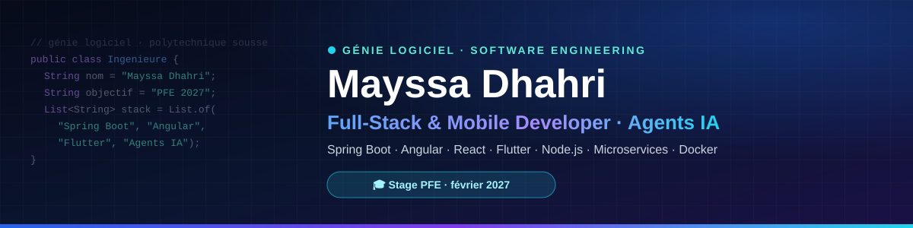

---

### 👋 À propos

- 🎓 Élève-ingénieure en **5ᵉ année de Génie Logiciel** à l'**École Polytechnique de Sousse** (Tunisie)
- 💼 **5 stages** en développement web, mobile et réseaux (2022 – 2026)
- 🔭 Je recherche un **stage de fin d'études (PFE) à partir de février 2027** : Full-Stack, Mobile, Microservices ou Agents IA
- 🌍 Ouverte à la **Tunisie**, la **Suisse** et au **remote**
- 🗣️ Arabe (natif) · Français (C1) · Anglais (B2)

> *Final-year Software Engineering student looking for an end-of-studies internship (Feb 2027) in Full-Stack, Mobile or AI-agent development.*

---

### 🛠️ Stack technique

  

  

| Domaine | Technologies |
|---|---|
| **Backend** | Java · Spring Boot · Spring Security (JWT) · JPA · Node.js · Express · FastAPI |
| **Frontend** | Angular · React · TypeScript · HTML/CSS |
| **Mobile** | Flutter / Dart · Kotlin · Java (Android) · React Native |
| **Architecture** | Microservices · API REST · GraphQL · gRPC · Apache Kafka · API Gateway |
| **DevOps** | Docker · Docker Compose · Jenkins · GitHub Actions · GitLab CI · Trivy |
| **IA** | Machine learning (Python) · Prompt Engineering · Agents LLM |

---

### 🚀 Projets à la une

| Projet | Description | Stack |
|---|---|---|
| 🤖 [**CareerMatch AI**](https://github.com/mayssadhahri1/careermatch-ai) | Agent IA qui compare un CV à une offre de stage : score pondéré, compétences manquantes, plan de progression, lettre de motivation (LLM local ou API, repli par règles) | Python · FastAPI · LLM (Ollama / OpenAI) · SQLAlchemy · Docker · CI |
| 🎫 [**SLA Desk**](https://github.com/mayssadhahri1/sla-desk) | Plateforme de support client : tickets, rôles (client / agent / admin), suivi des SLA en temps réel, machine à états, journal d'audit, tableau de bord | TypeScript · Node.js · Express · JWT · SQLite · Vitest · Docker · CI |
| 🎬 [**Smart Movie Platform**](https://github.com/mayssadhahri1/smart-movie-recommendation) | Plateforme de films : API REST sécurisée (JWT + Google), recommandations par genres, import TMDB, streaming vidéo (HTTP Range), dashboard admin | Spring Boot · MySQL · Angular · Flutter |
| 🔁 [**MERN CI/CD**](https://github.com/mayssadhahri1/mern-app) | Application MERN conteneurisée avec intégration continue sur 3 outils et scan de sécurité des images | Docker · Jenkins · GitHub Actions · Trivy |
| 📊 [**DevNet Dashboard**](https://github.com/mayssadhahri1/devnet-dashboard) | Supervision en temps réel du CPU, de la RAM et du disque, avec API météo | FastAPI · Streamlit · Docker · CI/CD |
| 🩺 [**MedecinApp**](https://github.com/mayssadhahri1/MedecinApp) | Application Android pour médecins : patients, rendez-vous, ordonnances, statistiques | Java · Android · SQLite · MPAndroidChart |
| 🍲 [**Recettes Kotlin**](https://github.com/mayssadhahri1/recette_app) | Application Android de recettes avec planning, notifications et carte | Kotlin · Retrofit · Google Maps |
| 🧩 [**Microservices gRPC + GraphQL**](https://github.com/mayssadhahri1/tp-microservices) | Services Films et Séries derrière une API Gateway REST + GraphQL | Node.js · gRPC · Apollo Server |

➡️ Tous mes projets : [**Repositories**](https://github.com/mayssadhahri1?tab=repositories)

---

### 💼 Expérience

- **Cyber Kairouan** — Stagiaire Développeuse Mobile Flutter (Stage PFA, 2026) · Full-Stack Angular / Spring Boot (été 2025)
- **Educanet Tunisie** — Stagiaire Développeuse Mobile & Web, projet *InMy Pharma* (2024)
- **ETC Tunisie** — Stagiaire Développeuse Web Full-Stack, Laravel / PHP (2023)
- **Tunisie Telecom** — Stage d'initiation Télécommunications & Réseaux (2022)

---

